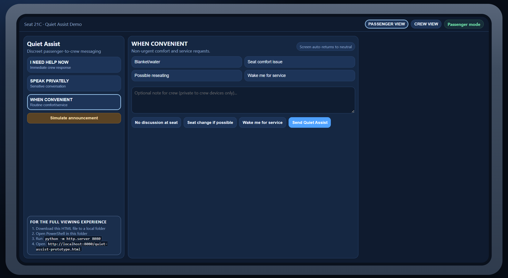
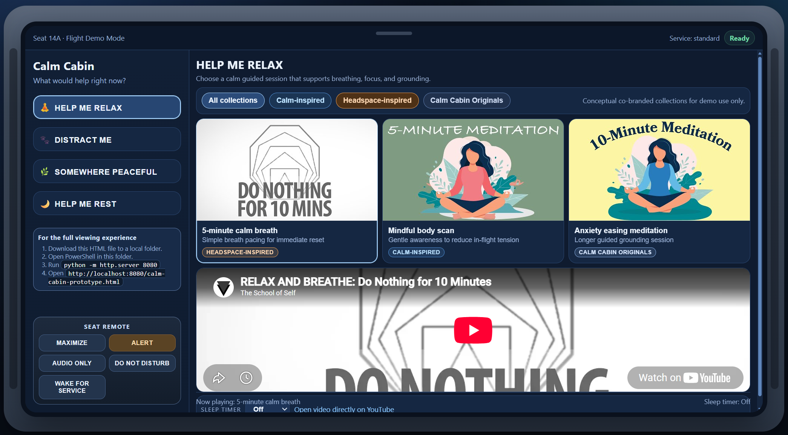

# Seatback Hackathon Prototype Suite

This repository contains four seatback-style hackathon prototypes:

1. **Calm Cabin**: wellness and rest-focused in-flight content experience.
2. **Quiet Assist**: discreet passenger-to-crew assistance and crew queue workflow.
3. **Flight Highlights**: camera views, route timeline, replay pins, and sharing summary flow.
4. **Travel Together**: synced watch party and social/group game concept experience.

## Screenshots

### Calm Cabin

### Quiet Assist

### Flight Highlights

### Travel Together

## Rendering instructions

1. Download or clone this repo to a local folder.
2. Open PowerShell in the repo root.
3. Run `python -m http.server 8080`.
4. Open the desired app:
   - `http://localhost:8080/calm-cabin-prototype.html`
   - `http://localhost:8080/quiet-assist-prototype.html`
   - `http://localhost:8080/flight-highlights-prototype.html`
   - `http://localhost:8080/travel-together-prototype.html`

