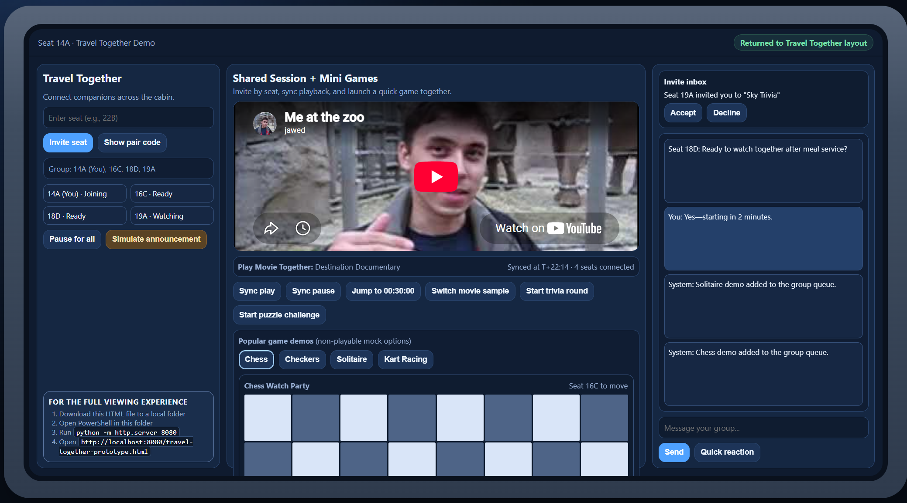

# Seatback Hackathon Prototype Suite

This repository contains four seatback-style concept submissions prepared for a **Microsoft internal hackathon** focused on reimagining in-flight digital experience. The concepts are structured as demo-ready prototypes for judging and storytelling ahead of the hackathon close on **October 30, 2026**.

## Calm Cabin

Calm Cabin reframes in-flight wellness as a focused seatback experience: passengers can quickly choose how they want to feel (relax, distract, peaceful scenery, or rest), set service preferences, and continue playback with minimal friction. The flow is designed to reduce decision fatigue and keep controls accessible in a constrained seatback viewport.

Project files: [calm-cabin/README.md](./calm-cabin/README.md)

## Quiet Assist

Quiet Assist demonstrates discreet help requests for sensitive situations, with urgency tiers, private follow-up preferences, crew-side triage, seat-map awareness, and language translation controls. The concept emphasizes privacy and rapid escalation, while still giving crew practical operational context.

Project files: [quiet-assist/README.md](./quiet-assist/README.md)

## Flight Highlights

Flight Highlights turns window moments into a timeline-driven discovery experience. Passengers can switch camera angles, revisit missed scenes by route pin, enable proactive notifications for notable moments, and generate post-flight summary/share content from what they viewed.

Project files: [flight-highlights/README.md](./flight-highlights/README.md)

## Travel Together

Travel Together explores social in-cabin entertainment: seat-to-seat invites, synchronized watch sessions, group chat, and visually rich game session previews. It focuses on turning isolated IFE usage into collaborative experiences suitable for friends, families, and ad hoc groups.

Project files: [travel-together/README.md](./travel-together/README.md)

## Rendering instructions

1. Download or clone this repo to a local folder.
2. Open PowerShell in the repo root.
3. Run `python -m http.server 8080`.
4. Open the desired app:
   - `http://localhost:8080/calm-cabin/calm-cabin-prototype.html`
   - `http://localhost:8080/quiet-assist/quiet-assist-prototype.html`
   - `http://localhost:8080/flight-highlights/flight-highlights-prototype.html`
   - `http://localhost:8080/travel-together/travel-together-prototype.html`
