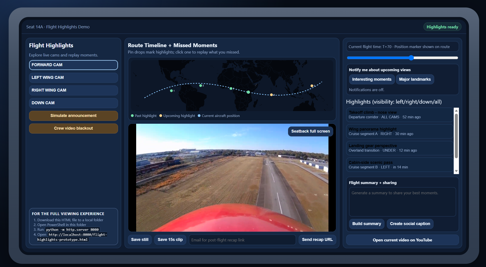

# Calm Cabin

Calm Cabin is a seatback wellness concept with guided modes, service preferences, and demo-friendly playback controls.

## Rendering instructions

1. Download or clone this repo to a local folder.
2. Open PowerShell in the repo root.
3. Run `python -m http.server 8080`.
4. Open `http://localhost:8080/calm-cabin-prototype.html`.

